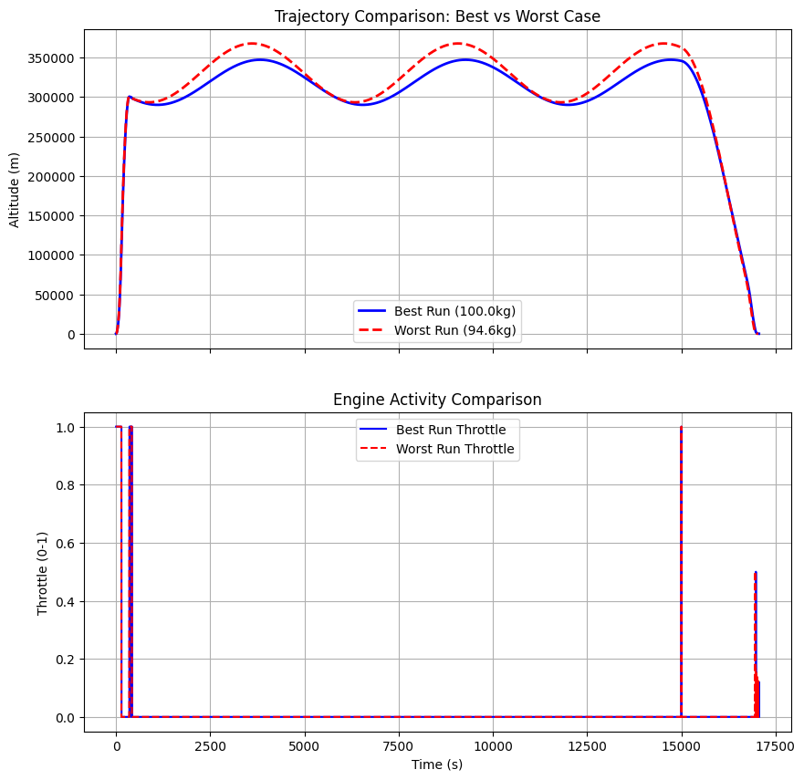
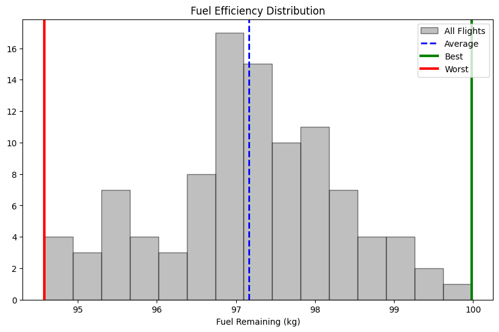
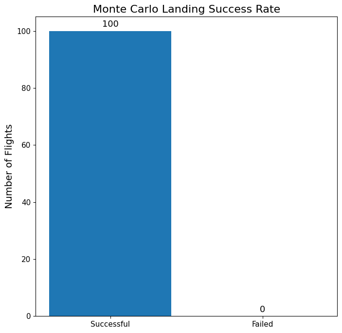

# Reusable Launch Vehicle GNC & Monte Carlo Simulation

A two-dimensional, physics-based Python simulation of a reusable launch vehicle through launch, orbital flight, deorbit, and powered descent. The project combines Keplerian orbit prediction, custom guidance and control logic, and Monte Carlo testing to evaluate performance under variations in initial conditions and simulated sensor measurements.

Reported result: In a batch of 100 Monte Carlo trials, all 100 satisfied the programmed terminal-state checks for vertical velocity, horizontal velocity, and remaining propellant. This is a result under the modeled conditions, not a claim of validated physical touchdown reliability.

## Project Overview

The simulation models a nominal 3,500 kg launch vehicle with two-dimensional motion, variable gravity, atmospheric drag, thrust-vector direction, and propellant consumption. It advances the vehicle state with forward-Euler integration and evaluates guidance and control decisions at 10 Hz.

The simulated mission consists of:
1. Launch and ascent: Apply full throttle during the launch burn.
2. Orbital flight: Estimate orbital properties using Keplerian relationships, including orbital energy and predicted apoapsis.
3. Deorbit: Use orbital-state prediction and apoapsis targeting in the logic for triggering the deorbit burn, with full throttle during the active burn.
4. Powered descent: Adjust thrust direction for lateral-velocity correction and throttle for vertical descent control using simulated velocity measurements.

The descent controller uses rule-based guidance and proportional vertical-velocity feedback; it is not a full PID or PD controller.

## Monte Carlo Test Setup
The test pipeline runs 100 simulated flights with variations in:
* Initial horizontal velocity: Randomized between trials.
* Initial vehicle mass: Small randomized perturbations around the nominal mass.
* Vertical-velocity measurements: Gaussian noise added to the measurements used by the powered-descent controller.

These tests examine sensitivity to the selected initial-condition and sensor-noise assumptions. Time-varying wind shear is not explicitly randomized in this version.

### Programmed Terminal-State Criteria
A trial is counted as successful by the program when its final state meets all three conditions:
| Check | Criterion |
| --- | --- |
| Vertical velocity | $v_y > -5\ \mathrm{m/s}$ |
| Horizontal velocity | $\lvert v_x\rvert < 2\ \mathrm{m/s}$ |
| Propellant remaining | Final vehicle mass exceeds the dry mass |

Test outcome: 100/100 trials (100%) passed these checks.

Important limitation: The current checks do not independently require an explicitly detected ground-contact event. Accordingly, the result should be interpreted as a terminal-condition pass rate in the simulation, rather than proof that every run produced a safe physical touchdown.

## Simulation Results

### 1. Trajectory and Engine Activity Comparison

The trajectory and engine-activity visualization compares selected simulated flights and their control histories. It helps examine orbital and descent paths, active engine phases, and the relationship between thrust-direction and throttle commands.

The model applies full throttle during launch and deorbit burns. During powered descent, it can use thrust direction for lateral corrections and throttle adjustments for vertical-speed control; it is not limited to full throttle throughout descent.

### 2. Remaining-Propellant Distribution

The remaining-propellant histogram illustrates variation across the simulated runs and provides a starting point for evaluating propellant margins. It does not, on its own, establish an optimal fuel load or validated safety margin.

### 3. Monte Carlo Landing Success Rate

The success-rate chart from the engineering portfolio summarizes the 100-trial Monte Carlo test batch: 100 trials met the programmed terminal-state criteria and 0 were classified as failures. These checks require vertical velocity greater than −5 m/s, absolute horizontal velocity below 2 m/s, and propellant remaining at the final state.

This 100% simulated pass rate describes only the sampled test cases and defined criteria; it does not establish a 100% probability of safe physical touchdown or performance under untested disturbances. The chart above is reproduced from the engineering portfolio.

## Technical Details

| Component | Implementation |
| --- | --- |
| Language | Python 3 |
| Libraries | NumPy, Matplotlib |
| Motion model | Two-dimensional equations of motion with variable gravity, atmospheric drag, thrust, and changing mass |
| Numerical integration | Forward Euler |
| Integration timestep / control interval | 0.1 s / 10 Hz |
| Nominal initial mass | 3,500 kg |
| Dry mass | 100 kg |
| Maximum thrust | 60,000 N |
| Guidance | Keplerian orbital calculations and phase-dependent burn logic |
| Descent control | Rule-based thrust-direction control and proportional vertical-velocity feedback |
| Test batch | 100 Monte Carlo runs |

## How to Run

### 1. Requirements

- Python 3.12 or later
- Jupyter Notebook or JupyterLab
- NumPy
- Matplotlib

Install the required packages using:

`pip install numpy matplotlib notebook`

### 2. Download the Repository

Clone the repository using Git:

`git clone https://github.com/roy1k-ctrl/Monte-Carlo-Rocket-Sim.git`

Navigate to the project directory:

`cd Monte-Carlo-Rocket-Sim`

### 3. Run the Simulation

Launch Jupyter Notebook:

`jupyter notebook`

Open `monte_carlo.ipynb` and select **Run All Cells**.

When prompted, enter the following parameters:

| Parameter | Example Value |
|---|---|
| Maximum Mass | 3500 kg |
| Minimum Mass (Dry Mass) | 100 kg |
| Maximum Thrust | 60000 N |

The program will execute 100 Monte Carlo simulations with randomized initial conditions and simulated sensor noise.

### 4. Review the Results

After completing the simulations, the notebook displays:

- **Monte Carlo Summary:** Success rate, average remaining propellant, and best/worst flight propellant values.
- **Trajectory and Engine Activity Comparison:** Altitude profiles and throttle histories for selected flights.
- **Fuel Remaining Distribution:** Histogram of remaining propellant across successful trials.
- **Landing Success Rate:** Bar chart showing the number of successful and failed trials according to the programmed terminal-state criteria.

**Note:** Results may vary between executions because the simulation uses random sampling without a fixed random seed. The reported success rate reflects the modeled conditions and programmed terminal-state criteria, not independently validated physical touchdown reliability.

## Scope and Limitations
This project is a simplified software simulation, intended to explore guidance, control, and repeatable test automation. Its present scope does not establish flight readiness or robustness to disturbances that were not modeled. In particular:
* The Monte Carlo inputs cover initial horizontal velocity, mass perturbations, and vertical-velocity measurement noise—not an explicit random wind-shear model.
* The integration method and planar dynamics are simplified approximations.
* The programmed success checks should be supplemented with explicit touchdown detection and physical validation before making stronger landing-reliability claims.

The next validation priorities are adding an unambiguous touchdown event, checking terminal conditions at touchdown, and expanding the disturbance model and test coverage.
